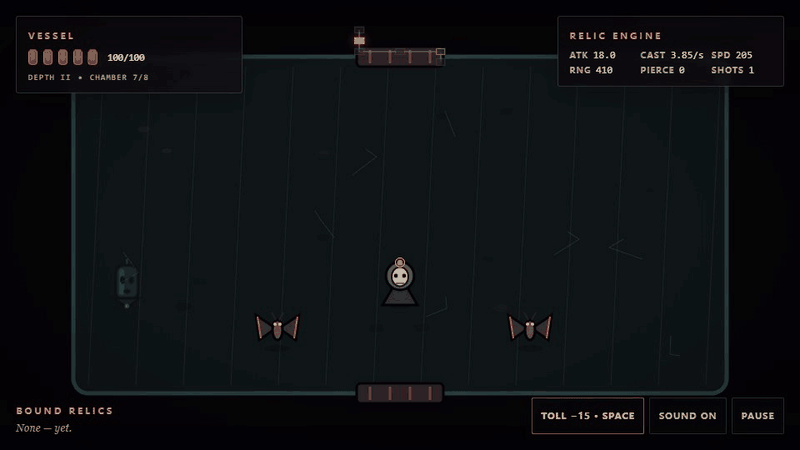

# Mournwell

A short room-by-room action game you play in the browser: fight down two depths of a haunted well, pick up relics that change how you shoot, and ring a toll bell that costs you health but hits everything in the room.

**[Play it](https://appleweiping.github.io/mournwell/)**: keyboard on desktop, two thumbsticks on a phone. No install, no account.

[](https://github.com/appleweiping/mournwell/actions/workflows/ci.yml)



_A chamber on Depth II with two ashmoths and a chimewraith. The bell rings about four seconds in: resolve drops by 15, the shots in the air vanish and every enemy takes 45 damage. Recorded from the dev build in headless Chromium; I used the dev build's test controls to jump straight to that chamber, and a small script pressed the keys._

## How to play

| Desktop                    | Phone / tablet | Does                                          |
| -------------------------- | -------------- | --------------------------------------------- |
| `W` `A` `S` `D`            | left stick     | move                                          |
| arrow keys                 | right stick    | cast in that direction (hold to keep casting) |
| `Space` or the TOLL button | TOLL button    | ring the bell                                 |
| `Esc` or `P`               | PAUSE          | pause                                         |

Each run starts on **Depth I, the Bell Archive**: 5 to 8 chambers, one treasure room and the Tollmother waiting in the room farthest from the start. A combat chamber seals its doors until everything in it is dead. Beat the Tollmother and a well opens in the floor; step in and you drop to **Depth II, the Drowned Belfry** with your relics and remaining resolve, into a new layout and a second, angrier Tollmother. Beat her and the run is won. You can type a seed on the title screen; the same seed gives the same layouts and rewards.

**The toll bell.** Ringing it costs 15 resolve (out of 100). Every enemy in the chamber takes 45 damage and freezes for a moment, and all enemy shots in flight are swept away. It then needs 8 seconds of silence before it rings again, and it will not ring if 15 resolve would kill you. 45 damage kills a siltling in the first few chambers outright and takes a big bite out of everything else; on Depth II enemies are tougher, so it softens a room rather than clearing it, and against a Tollmother it buys you a breather rather than a win.

### Enemies

|                | Where             | What it does                                                                                                             |
| -------------- | ----------------- | ------------------------------------------------------------------------------------------------------------------------ |
| Siltling       | both depths       | wobbles toward you, then lunges                                                                                          |
| Wickspitter    | both depths       | keeps its distance, glows, then spits a three-shot fan                                                                   |
| Knellguard     | both depths       | armoured from the front; lines up and charges, and is stunned if it hits a wall                                          |
| Ashmoth        | Depth II          | darts at angles around you; bursts into a ring of slow embers when it dies                                               |
| Chimewraith    | Depth II          | fades out (you cannot hit it then), reappears beside you, glows and fires two aimed shots                                |
| The Tollmother | end of each depth | three phases: aimed fans, then rings of shots plus helpers (siltlings on Depth I, ashmoths on Depth II), then fast rings |

### Relics

Eight relics drop from chests, the treasure room and the occasional kill. Duplicates stack.

| Relic           | Effect                                         |
| --------------- | ---------------------------------------------- |
| Iron Lament     | more damage, heavier shots                     |
| Quickwick       | faster casting                                 |
| Longglass       | longer range, faster shots                     |
| Mudrunner Soles | faster movement                                |
| Blackwax Knot   | more maximum resolve, and heals the difference |
| Twin Rune       | three shots per cast, then five                |
| Briar Eye       | shots pierce through enemies                   |
| Compass Moth    | shots bend toward enemies                      |

## Run it locally

Needs Node.js 22 or newer.

```bash
git clone https://github.com/appleweiping/mournwell.git
cd mournwell
npm ci
npm run dev            # http://localhost:4173
npm test               # unit tests (Vitest)
npx playwright install chromium
npm run test:e2e       # plays the game with real keyboard and touch input
```

Everything you see is drawn with Phaser graphics calls and every sound is synthesized with the Web Audio API at runtime; there are no image or audio files. How the code fits together is in [docs/ARCHITECTURE.md](./docs/ARCHITECTURE.md).

## Credits

The room-clearing structure is borrowed from _The Binding of Isaac_. The characters, art, sounds, names and numbers here are original. Mournwell is not affiliated with Edmund McMillen or Nicalis.

## License

[MIT](./LICENSE). Phaser and EventEmitter3 notices are in [THIRD_PARTY_NOTICES.md](./THIRD_PARTY_NOTICES.md).
